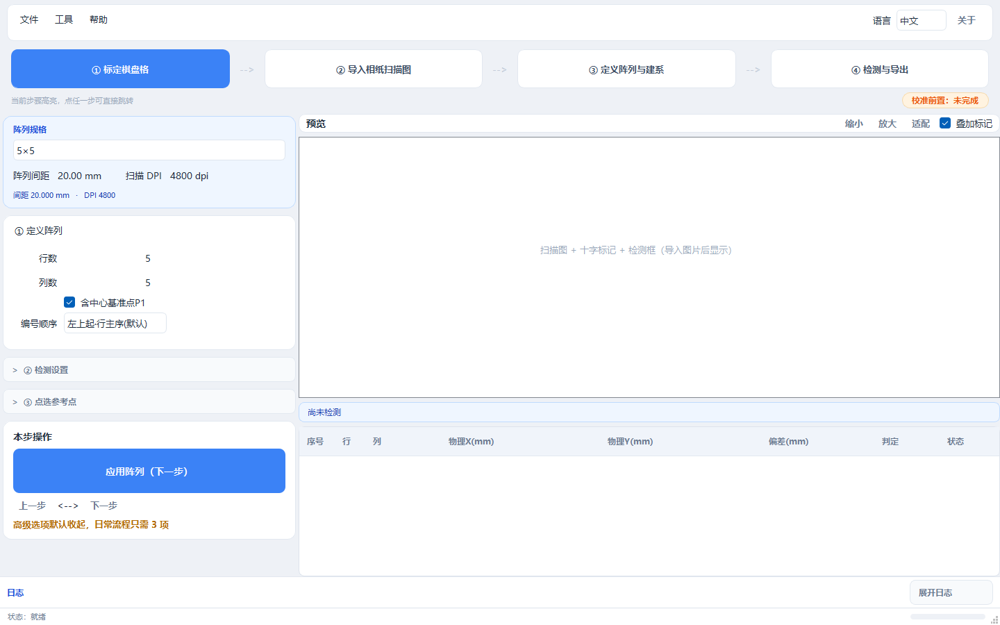

# GalvoCalibVision

[](https://github.com/Talon-Yuan/galvo-calib-vision/stargazers)
[](https://github.com/Talon-Yuan/galvo-calib-vision/network/members)
[](LICENSE)
[](requirements.txt)
[](#快速开始)

[中文](#中文) | [English](#english)



> 如果这个项目帮到你，点个 ⭐ 就是最大的支持 —— 欢迎 [Star](https://github.com/Talon-Yuan/galvo-calib-vision/stargazers) 后回来提 issue 交流。

---

## TL;DR (English)

**Turn a 4800-dpi flatbed scanner into a vision measuring machine for galvo marking arrays.**
Scan a printed target, locate cross centers to sub-pixel accuracy, compare against the nominal grid,
export an Excel report — as an engineering replacement for a six-figure 2D vision measuring machine.

- **Accuracy on real data:** RMS 0.0785 mm / Max 0.2232 mm (5×5 array, 30 mm pitch, 4800 dpi)
- **Huge scans:** tiled decoding, tested at 2.23 Gpx without OOM
- **Honest framing:** 3-DOF only (rotation + translation). Shear/scaling fitting is *refused* on purpose,
  so residuals cannot be made to look better than the machine really is
- **Verification built in:** `tools/selfcheck.py`, `tools/core_ab.py` (numeric A/B fingerprints),
  `tools/core_guard_tests.py` — every algorithm change can be proven value-invariant
- **UI:** PyQt5, dark/light themes, Chinese/English, built-in manual (F1)

```bash
pip install -r requirements.txt
python app.py
```

Workflow: ① calibrate chessboard → ② import scanned sheet → ③ define array & frame → ④ detect & export.
Full English section below ↓ · [Download the Windows build](https://github.com/Talon-Yuan/galvo-calib-vision/releases/latest)

---

## 中文

### 一句话

把 4800dpi 扫描仪变成一台"视觉测量仪"：扫相纸 → 亚像素找十字 → 和名义网格比对 → 出 Excel 报表。
用来校验**振镜（Galvo）打标阵列**的精度，替代动辄几十万的二次元影像仪。

### 为什么做这个

打标/振镜设备出厂或换镜头后，需要确认"打出来的阵列到底偏多少"。传统做法是上二次元影像仪逐点量，
慢、贵、还排不上队。我们换成：**普通 4800dpi 扫描仪 + 一块打印好的棋盘格 + 这套软件**。

- 一张 A4 相纸、一次扫描，25 个点全测完
- 亚像素级十字定位，误差压到 **RMS 0.08 mm** 量级
- 报表能追溯到每一次决策（标定残差、建系夹角、是否精化）

### 核心能力

| 能力 | 说明 |
|---|---|
| 超大图处理 | 分块解码，实测 2.23 Gpx / 约 4.4 GB 解码内存不崩 |
| 棋盘格标定 | 自动识别行列 + 分区校正场（3×3 一阶仿射，边界 IDW 融合） |
| 亚像素十字检测 | 投影质心 / 寻边中线交点（默认），带置信度评分，低置信显式标 `DETECT_FAIL` |
| 严格 3 DOF 建系 | 只允许旋转 + 平移，禁止剪切/缩放（防止"拟合出好看的假精度"） |
| 刚体精化 | SVD 3DOF，**无改善自动回滚**，不硬写结果 |
| 多摆放残差校正 | 同一基准板 5 种摆放，SVD 配准 + LOO 交叉验证 |
| 工程化 | 深色/浅色主题、中英双语、内置说明书（F1）、自检 + 数值 A/B 工具链 |

### 精度（真实数据）

验收口径：**合成 RMS ≤ 0.15 mm、Max ≤ 0.40 mm**；标定合格线 RMS ≤ 0.05 mm。

| 样本 | RMS (mm) | Max (mm) | 结论 |
|---|---|---|---|
| 5×5 / 30 mm / 4800 dpi（样本①） | 0.0785 | 0.2232 | 达标 |
| 5×5 / 30 mm / 4800 dpi（样本②） | 0.0776 | 0.1929 | 达标 |
| 翘曲样件（二次元独立测量 0.2569） | 0.2412 | 0.5293 | 样件真实超差，非软件误差 |

> 这不是通用测量仪器：精度取决于扫描仪、标定板平整度与相纸状态。

### 快速开始

**方式一：直接下载（普通用户）**

到 [Releases](https://github.com/Talon-Yuan/galvo-calib-vision/releases/latest) 下载
`GalvoCalibVision_v4.0_windows_x64.zip` → 解压 → 双击 `GalvoCalibVision.exe`（免安装，整个目录可拷贝）

**方式二：源码运行（开发者）**

```bash
git clone https://github.com/Talon-Yuan/galvo-calib-vision.git
cd galvo-calib-vision
pip install -r requirements.txt
python app.py
```

环境要求：Windows 10/11 x64 + Python 3.10+（PyQt5 桌面端）；`core/` 算法层可脱离界面单独调用。

四步流程：**① 标定棋盘格 → ② 导入相纸扫描图 → ③ 定义阵列与建系 → ④ 检测与导出**

详细步骤见 [操作说明书](docs/操作说明书.md)；每个按钮干什么见 [按钮说明书](docs/按钮说明书.md)。

### 架构

```
app.py                  入口（崩溃落盘 logs/crash_*.txt）
core/                   算法层（17 模块，可脱离 GUI 单独调用）
├── image_loader.py     大图加载 / 分块 ROI / 预览降采样
├── tile_source.py      分块源（超大幅面按需解码）
├── calibrator.py       棋盘格检测 + 多项式/分区校正场
├── cross_detector.py   十字中心亚像素检测
├── coordinate_frame.py 像素↔物理换算、建系拟合、残差分解
├── grid_definition.py  名义网格（pitch 驱动）
├── point_order.py      编号顺序（4 种模式）
├── registration.py     同幅配准（仿射/相似/二次多项式 + LOO）
├── residual_*.py       残差层、残差分析
├── multi_pose_fit.py   多摆放刚体配准
├── piecewise_correction.py  分区校正场
├── excel_exporter.py   Excel 报表（列结构稳定）
gui/                    PyQt5 界面（主窗口 / 标定页 / 预览画布 / 主题 / i18n / 说明书）
tools/                  selfcheck 自检、core_ab 数值 A/B、守卫测试、截图
docs/                   操作 / 按钮 / BUG 解决说明书
```

### 工程质量

- `tools/selfcheck.py`：编译、离屏启动、三页签、主题切换、i18n 完整性、core 基线校验
- `tools/core_ab.py`：固定输入数值指纹 A/B —— 改算法前后**逐项对比**，防止"优化把精度改坏"
- `tools/core_guard_tests.py`：非法输入必须被拦下（点数不足/共线/尺度异常）
- 全部 GUI 缺陷（含 2 个崩溃级）来自一次独立代码评审，修复记录见 [BUG 解决说明书](docs/BUG解决说明书.md)

### 构建可执行文件

```bash
pip install pyinstaller
pyinstaller --noconfirm --windowed --name GalvoCalibVision app.py
```

### 适合谁

- 振镜/激光打标设备厂商：出厂校验、换镜头后复测
- 视觉/自动化集成商：需要一套可改、可查、可追溯的离线测量工具
- 学生/研究者：想学"大图 + 亚像素 + 标定 + 报表"完整链路

**不适合**：需要 µm 级精度的计量场景（请用真正的影像仪）；手持拍照场景（本工具假设扫描仪平面）。

### 参与

欢迎 issue / PR：真实工况数据（可脱敏）、检测算法改进、其他语言的说明书翻译。
提交前请跑一遍 `python tools/selfcheck.py`。

---

## English

### What it is

Turn a 4800-dpi flatbed scanner into a vision measuring machine: scan a printed sheet, locate cross
centers with sub-pixel precision, compare against the nominal grid, and export an Excel report.
Built to validate **galvo marking arrays** without a six-figure 2D vision measuring machine.

### Why

After building or re-focusing a galvo marking system you need to know how far the array is off.
The usual answer is a 2D vision measuring machine — slow, expensive, often booked. This project
replaces it with: **a consumer 4800-dpi scanner + a printed chessboard + this software**.

One A4 sheet, one scan, 25 points measured. Sub-pixel cross localization keeps the error around
**RMS 0.08 mm**. Every report is traceable: calibration residual, framing angle, whether refinement
was applied.

### Highlights

| Area | What |
|---|---|
| Huge scans | Tiled decoding; tested with 2.23 Gpx / ~4.4 GB decoded, no crash |
| Calibration | Auto-detected chessboard + piecewise correction field (3×3 affine, IDW blending) |
| Sub-pixel detection | Projection centroid / edge-midline (default), confidence scored; low confidence is explicitly marked `DETECT_FAIL` |
| 3-DOF framing only | Rotation + translation. No shear/scaling — prevents "pretty-looking fake accuracy" |
| Rigid refinement | SVD 3-DOF with **automatic rollback** when it does not improve |
| Multi-pose residual | Five poses of the same target, SVD alignment + leave-one-out validation |
| Engineering | Dark/light themes, ZH/EN UI, built-in manual (F1), self-check + A/B numeric harnesses |

### Accuracy (real data)

Acceptance: **composite RMS ≤ 0.15 mm, Max ≤ 0.40 mm**; calibration pass line RMS ≤ 0.05 mm.

| Sample | RMS (mm) | Max (mm) | Verdict |
|---|---|---|---|
| 5×5 / 30 mm / 4800 dpi (#1) | 0.0785 | 0.2232 | pass |
| 5×5 / 30 mm / 4800 dpi (#2) | 0.0776 | 0.1929 | pass |
| Warped target (independent reference 0.2569) | 0.2412 | 0.5293 | target is genuinely warped, not a software error |

> Not a general-purpose metrology device: accuracy depends on scanner, target flatness and media.

### Quick start

**Option A — download (most users)**

Grab `GalvoCalibVision_v4.0_windows_x64.zip` from [Releases](https://github.com/Talon-Yuan/galvo-calib-vision/releases/latest),
unzip it, and run `GalvoCalibVision.exe`. No installer; the folder is portable.

**Option B — run from source**

```bash
git clone https://github.com/Talon-Yuan/galvo-calib-vision.git
cd galvo-calib-vision
pip install -r requirements.txt
python app.py
```

Requires Windows 10/11 x64 + Python 3.10+ (PyQt5 desktop app); the `core/` layer works standalone.

Workflow: **① calibrate chessboard → ② import scanned sheet → ③ define array & frame → ④ detect & export**

### Build a standalone exe

```bash
pip install pyinstaller
pyinstaller --noconfirm --windowed --name GalvoCalibVision app.py
```

### Who it is for

- Galvo / laser marking OEMs: factory validation, re-verification after lens changes
- Machine-vision integrators: a readable, auditable offline measurement tool
- Students / researchers: an end-to-end example of large-image, sub-pixel, calibration and reporting

**Not for**: µm-level metrology (use a real measuring machine); handheld photos (the pipeline assumes
a flatbed scan plane).

### Contributing

Issues and PRs welcome: real-world (anonymized) datasets, detector improvements, translations.
Please run `python tools/selfcheck.py` before submitting.

## 致谢 / Acknowledgements

这个项目能走到开源，要特别感谢两位：

- **大肥鱼（DeepSeek）** —— AI 搭档。从代码评审、缺陷修复、数值 A/B 验证，到深色模式重做、说明书与打包流水线，
  大部分工程化工作是在与它的一次次对话里磨出来的。它把"改完要自证"这件事变成了流程。
- **苏州天弘** —— 提供了真实工况与测试条件（4800dpi 扫描、打标样件、二次元独立比对数据），
  让这套方法不是纸面玩具，而是能在产线上跑的工具。

也感谢这些开源项目：**PyQt5 · OpenCV · NumPy · openpyxl · PyInstaller** —— 没有它们就没有这个软件。

完整致谢与依赖清单见 [ACKNOWLEDGEMENTS.md](ACKNOWLEDGEMENTS.md)。

### Star History

[](https://star-history.com/#Talon-Yuan/galvo-calib-vision&Date)

## License

Apache License 2.0 — see [LICENSE](LICENSE).

## Documentation

- [操作说明书 / User guide](docs/操作说明书.md)
- [按钮说明书 / UI reference](docs/按钮说明书.md)
- [BUG 解决说明书 / Defect history](docs/BUG解决说明书.md)
- [CHANGELOG](CHANGELOG.md)
